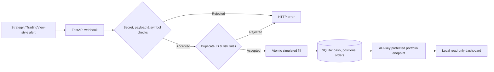

<div align="center">

# TradeMesh AI
### Trading automation infrastructure. Built with a risk-first engineering approach.

**Signal intake · Simulated execution · Portfolio state · Risk checks · Operator visibility**

[](#quick-start)
[](#architecture)
[](LICENSE)
[](#implementation-status)
[](#implementation-status)

**[Explore the code](src/trademesh/api.py) · [See the dashboard source](src/trademesh/static/index.html) · [Review tests](tests/test_api.py) · [Technical case study](docs/CASE_STUDY.md) · [Discuss an integration](https://nextgentechdev.com)**

</div>

---

## The problem worth solving

Trading automation becomes unreliable when alerts, order routing, risk limits and portfolio state live in separate systems. A signal may be repeated; an order may exceed available capital; a trader may have no clear audit trail.

**TradeMesh AI explores how to make those boundaries explicit and testable.**

The current release is a compact **paper-only proof of concept**, not a production trading platform. Its focus is engineering discipline—not a claim about profitable trading strategies.

## See the product in 60 seconds

**1. Start the local API** after configuring environment variables. **2. Open the responsive dashboard** at `http://127.0.0.1:8000/`. **3. Submit a simulated buy alert** to `POST /webhook`. **4. Review the portfolio and order record.** Repeat the same alert ID to see duplicate processing rejected.

| Working capability in v0.1 | Why it matters |
| :--- | :--- |
| TradingView-style JSON webhook | A straightforward integration point for external strategy signals |
| Long-only, USD-quoted crypto spot simulation | Shows end-to-end order flow without a funded account |
| Atomic SQLite order journal | Persists simulated orders and account state |
| Duplicate signal ID protection | Prevents a repeated alert ID from being processed twice |
| Basic pre-trade risk checks | Rejects orders beyond cash, per-order and per-symbol limits |
| Protected portfolio endpoint + local dashboard | Lets an operator inspect paper balances, positions and orders |
| Python API test suite | Supplies repeatable examples of expected and rejected behavior |

**Supported demo instruments:** `BTCUSDT`, `ETHUSDT`, `SOLUSDT`. **Simulated initial cash:** $10,000. **Per-order cap:** $2,000. **Per-symbol exposure cap:** $3,000. Limits are currently fixed in the prototype.

> **Important:** Signal prices are supplied by the sender—not verified against a real exchange. There are **no real orders, fees, slippage, spreads, live quotes, network delays, P&L reporting or exchange fill reconciliation**. A simulated fill does not demonstrate a profitable strategy or real-world execution quality.

## Architecture



**Design boundaries:** Webhook messages are untrusted input; simulated trades are long-only; the order ID is an idempotency key; portfolio reads require a separate API key. The system is intended for local evaluation only.

### Navigate the source

| Area | Where to look |
| --- | --- |
| API routes, validation and simulation | [src/trademesh/api.py](src/trademesh/api.py) |
| Responsive dashboard | [src/trademesh/static/index.html](src/trademesh/static/index.html) |
| Automated API tests | [tests/test_api.py](tests/test_api.py) |
| Example alert body | [examples/tradingview-alert.json](examples/tradingview-alert.json) |
| Container setup | [Dockerfile](Dockerfile) · [docker-compose.yml](docker-compose.yml) |
| Threat model and limitations | [SECURITY.md](SECURITY.md) |
| Development roadmap | [ROADMAP.md](ROADMAP.md) |
| Engineering decisions / client evaluation | [docs/CASE_STUDY.md](docs/CASE_STUDY.md) |

## Quick start

### Option A — Python 3.11+

```bash
git clone https://github.com/rajachanna/TradeMesh-AI.git
cd TradeMesh-AI
python -m venv .venv
# macOS/Linux: source .venv/bin/activate
# Windows: .venv\Scripts\activate
pip install -r requirements.txt
cp .env.example .env
```

In `.env`, replace the two placeholder secrets with **different random values of 16+ characters**. `.env` is ignored by Git; never publish secrets.

```bash
# macOS / Linux: load .env then run locally
set -a; source .env; set +a
uvicorn trademesh.api:app --app-dir src --host 127.0.0.1 --port 8000
```

For PowerShell, set the environment variables manually before launching Uvicorn. This prototype does not automatically load the `.env` file outside Docker.

### Option B — Docker

```bash
cp .env.example .env
# Edit both secrets in .env
docker compose up --build
```

The Docker setup binds the API to **127.0.0.1:8000**, not the public internet.

Once started:

- **Dashboard:** http://127.0.0.1:8000/
- **Interactive API docs:** http://127.0.0.1:8000/docs
- **Health:** http://127.0.0.1:8000/health

### Run a small, repeatable demonstration

Send a simulated buy using a unique ID; replace the placeholder secret with your `TM_WEBHOOK_SECRET`:

```bash
curl -X POST http://127.0.0.1:8000/webhook \
  -H "Content-Type: application/json" \
  -d '{"secret":"YOUR_TM_WEBHOOK_SECRET","id":"demo-order-001","symbol":"BTCUSDT","side":"buy","quantity":"0.01","price":"65000"}'
```

Expected response: `{"status":"paper_filled","mode":"PAPER_ONLY","id":"demo-order-001"}`

Re-send with the **same ID** to see `"status":"duplicate"`. Check the simulated state:

```bash
curl -H "X-API-Key: YOUR_TM_API_KEY" http://127.0.0.1:8000/portfolio
```

This is a **mock-priced example**, not a market quote.

### Evaluate the tests

```bash
pip install -r requirements-dev.txt
PYTHONPATH=src pytest -q
```

PowerShell: `$env:PYTHONPATH="src"; pytest -q`

Tests cover valid and rejected requests, missing credentials, duplicate order IDs, a simulated round trip and exposure checks. **No CI passing status or independent test audit is claimed here.**

## Implementation status

| Platform / capability | Status |
| --- | --- |
| Paper-only webhook, simulation, dashboard, risk checks | **Implemented (prototype)** |
| TradingView production webhook hardening, replay protection | Planned |
| Interactive Brokers (IBKR) paper account adapter | Planned |
| MetaTrader 5 demo integration | Planned |
| Centralized exchange sandbox connectors | Planned |
| DEX price/swap simulation | Planned |
| Cross-venue analytics, strategy backtesting, AI assistant | Planned |
| Production live execution | **Not available** |

For the full sequence and technical gates, see [ROADMAP.md](ROADMAP.md).

## Why this project is in the portfolio

The goal is to demonstrate **systems thinking**: defining interfaces, isolating paper execution from real money, preserving state, validating requests and writing tests for negative cases. These are the fundamentals behind serious broker/exchange automation projects.

For custom engagements, the same methodology can be applied to **MT5/Forex workflows, IBKR integrations, crypto exchange API connectivity, signal execution bridges and portfolio risk monitoring**—with separately defined requirements, milestones and acceptance criteria.

Read the [technical case study](docs/CASE_STUDY.md) for design decisions and an honest assessment of remaining work.

## Developer & collaboration

**Raja Channa · NextGen Tech Solutions**

Algorithmic trading software · Python automation · Broker/exchange API integrations · AI-assisted workflows

🌐 **Website / inquiries:** https://nextgentechdev.com  
💻 **GitHub:** https://github.com/rajachanna  
🛠 **Suggested evaluation:** review the code → run the local demo → execute the tests → discuss a defined integration.

**MIT License.** Contributions and technically specific issues are welcome.

<sub>**Disclaimer:** Trading can lose money. This repository is an experimental, paper-only software demonstration; it does not give investment advice or guarantee strategy profitability. Do not connect it directly to live-funded accounts or expose it to the public internet without a security and architecture review.</sub>
